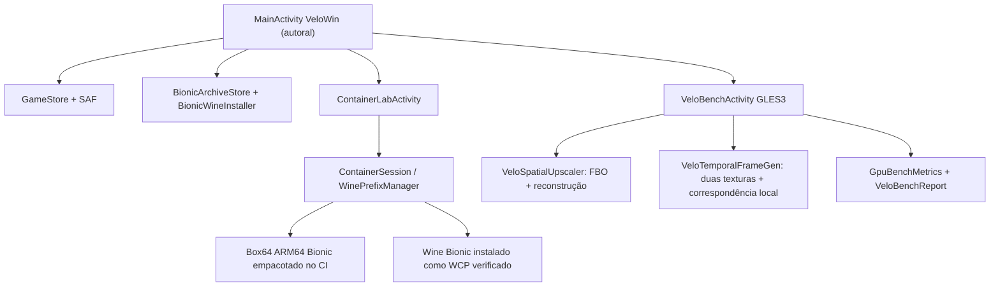

# VeloWin v21 — arquitetura executada pela branch standalone

## Fluxo real do APK

O caminho gráfico Windows **não está ligado** ao benchmark:
`Wine -> XServer JNI -> Surface Android -> DXVK/Vulkan -> áudio/input`
é um trabalho de engenharia ainda não integrado nesta branch.
O antigo caminho WinNative que fazia isso está conservado na v18/v19,
**não** carregado, copiado nem compilado nesta build standalone.

## Componentes próprios

| Módulo | Contrato real | Teste |
|---|---|---|
| `app` | Launcher, biblioteca, runtime e testes de console Bionic | Android Gradle |
| `modules/velowin-core` | Políticas de qualidade, estados, métricas e resultado | JVM |
| `app/.../graphics/VeloSpatialUpscaler` | Renderizar em resolução reduzida e reconstruir a textura | Build GLES3 + teste físico pendente |
| `app/.../graphics/VeloTemporalFrameGen` | Capturar duas imagens reais GLES3, estimar deslocamentos locais e criar uma imagem intermediária | Build GLES3 + teste físico pendente |
| `app/.../benchmark/VeloBenchActivity` | Desenhos de cubos GLES3, encerramento de sessão, exportação | Build Android; GPU física pendente |
| `app/.../engine/ContainerSession` | Diagnósticos reais Wine Bionic/Box64 sem servidor gráfico | Somente comandos de console, sem janela |
| `VeloGpuPolicy` | Limite de memória RGBA8, refresh e estado térmico | JVM |

## Fontes e licenças

- O app VeloWin é recuperado da árvore original da branch `main`
  (anterior à v14) e extendido por código próprio.
- Box64: `ptitSeb/box64`, commit
  `c6a8c4472f74f9ad204d35195f084b5f996b12e3`,
  licença MIT; código compilado separadamente pelo CI e licença
  empacotada em `assets/BOX64_LICENSE.txt`.
- AMD GPUOpen FidelityFX FSR 1 (MIT): **referência técnica**,
  nenhum shader AMD copiado nem nomes comerciais atribuídos ao efeito.
- glmark2 (GPLv3): referência metodológica para geometria; código
  original da Activity VeloBench, não port do glmark2.
- Wine/Proton WCP, quando instalados: devem preservar suas licenças
  originais. Instalar Wine não confere suporte a janelas/DXVK.
- WinNative/Winlator: fontes da versão anterior estão no histórico e
  nas branches legadas; sem imports, checkout e execução no APK v21.

## Métricas e proteções

- `glFinish` mede cadência da thread GL + GPU; não lê
  timestamps reais de apresentação do SurfaceFlinger.
- Quadros intermediários são **imagens distintas calculadas**, não
  imagens repetidas; output pode ter artefatos de motion matching.
- Interpolação usa dois RGBA8 e restrição a 4 MP por superfície;
  térmico severo Android (status >= 4) desativa a etapa experimental.
- Alterações de resolução, modo ou carga descartam amostras anteriores.
- Fallback para resolução nativa caso a criação do FBO falhe.
- Nenhuma pontuação fabricada, desempenho Mali presumido ou
  instalação de Turnip para Mali.

## Gates para restabelecer execução gráfica Windows

1. Portar X11/JNI e compositor Android com atribuição de fontes, CI e
   teste de primeira janela real sem regressão da tela preta.
2. Integrar Wine Bionic e Box64 ao processo com supervisão de PIDs,
   prefixos duráveis e encerramento seguro.
3. Integrar áudio, teclado, mouse, touchscreen e controladores.
4. Separar instalação de drivers e compatibilidade Vulkan Mali,
   DXVK, VKD3D e WineD3D conforme capacidades medidas.
5. Conectar FrameGen a um compositor de quadros autorizado e medir
   latência e apresentação real em hardware. Sem estes passos, v21
   permanece experimental e não deve substituir a v18/v19.
