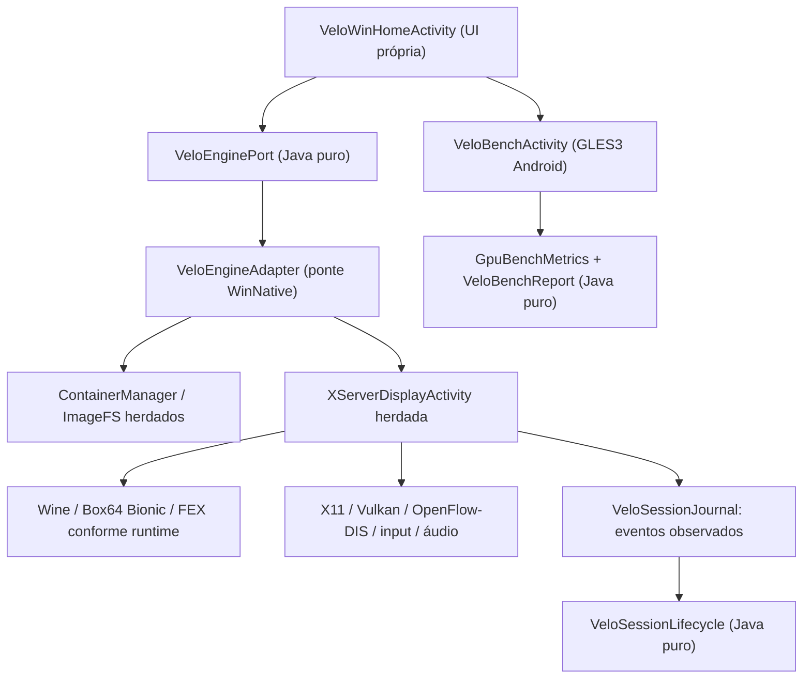

# Arquitetura VeloWin — situação atual (v19 com incrementos v20)

> Histórico: as versões 0.1–0.3 não executavam Wine em contêiner.
> Este documento descreve o **APK gráfico atual**, construído pelo
> workflow `.github/workflows/velowin-native.yml`, não aquele laboratório.

## O que realmente compila

O aplicativo **dev.velowin.app** ainda incorpora os serviços gráficos,
Wine, Box64, ImageFS, JNI, áudio e controles da árvore WinNative fixada
em `8409085f706acbc0749881d9bf1e85f2f347dfd4`.
O checkout é referenciado por `.gitmodules` e preparado por
`tools/prepare-winnative.py`, `tools/strip-lsfg.py`,
`tools/patch-v17.py` e `tools/patch-v18.py`. Isto não é independência
de runtime concluída e não deve ser apresentado como tal.

O build Gradle executado pelo CI é
`third_party/winnative/gradlew :app:assembleStandardDebug`,
**após aplicar overlays e patches rastreados neste repositório**.
Mudar apenas `build.gradle` na raiz não altera o APK real.

## Mapa de execução

A Home não chama diretamente a Activity XServer, mas depende de
Container e ContentsManager do upstream para criar e listar contêineres.
Não é uma arquitetura de runtime inteiramente desacoplada.
O VeloBench roda no Android nativo; não testa DXVK nem executa Windows.

## Limites confiáveis

- **Abertura Wine:** o proprietário confirmou funcionamento na v18.
  Nenhum resultado físico foi fornecido para a nova revisão.
- **FrameGen:** OpenFlow/DIS Vulkan já foi comprovado no aparelho para
  a v18. A pipeline operacional é preservada; não alegar novos ganhos
  de FPS ou novo shader proprietário.
- **Estados da sessão:** PREPARING não significa Wine pronto; RUNNING
  depende do callback do primeiro mapeamento guest; 35s sem janela
  ainda disparam recuperação.
- **Mali:** wrapper Vulkan do sistema, fallback WineD3D/X11 e opção
  reversível 1280x720. Nenhum driver Turnip é instalado em Mali.
- **Benchmark:** usa glDrawElements GLES3 e glFinish; mede cadência
  observada pela thread GL, não apresentação física ou FPS DIS.
- **Binários FEX/glibc/PRoot:** rotas e perfis dependem de instalações
  externas compatíveis. Não declarar funcionalidade universal.

## Caminho para retirar o motor monolítico

1. Extrair configuração, persistência e catálogo dos contêineres,
   mantendo leituras de prefixos antigos sem conversão automática.
2. Criar um executor de processos Wine/Box64 próprio, com supervisão
   de PID e verificação de janela real antes de retirar classes.
3. Portar X11 JNI, input, áudio e WSI gráfico em integrações testáveis.
4. Vincular drivers específicos ao ABI e GPU realmente detectados.
5. Somente remover `third_party/winnative` quando uma sessão Wine real
   abrir em hardware sem regressão, com atribuições e fonte correspondente.

Consulte `docs/DEPENDENCY_INVENTORY_V20.md`,
`docs/BLACK_SCREEN_RECOVERY_V18.md`,
`docs/SESSION_OBSERVABILITY_V20.md` e
`docs/BENCHMARK_LIFECYCLE_V20.md`.

## Preservação e distribuição

Não apague ImageFS, contêineres ou prefixos para migrar. Um APK de CI
assinado com chave **debug** pode ter assinatura diferente de outro APK;
uma atualização in-place não deve ser prometida sem comparar assinaturas.
Não desinstale a versão funcional sem fazer backup verificável dos dados.
Faça rollback pelo código da v18, commit
`e8483a7c9d62ce96627901559aaffc8d7d51e263`, preservando os dados.
Mergir na main requer testes de compatibilidade e execução no aparelho.
